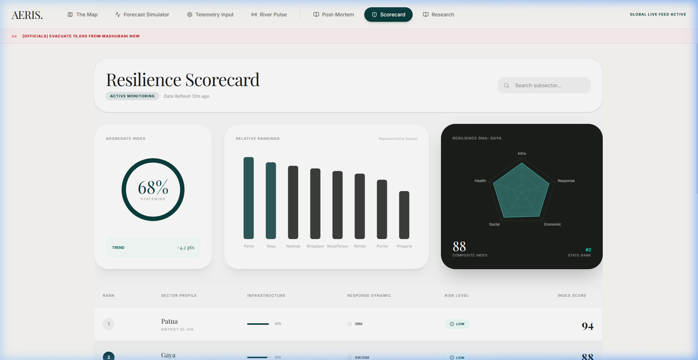
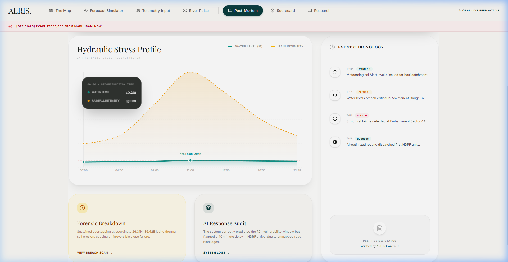
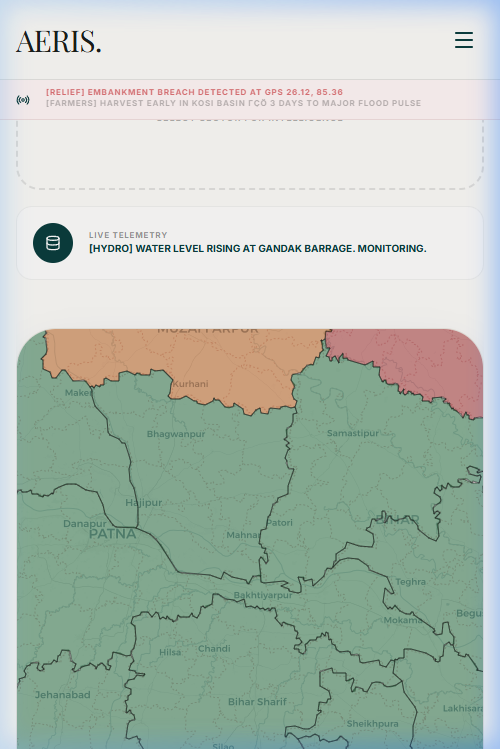

# AERIS — AI-Enhanced Risk Intelligence System

> **Predict. Prepare. Protect.** A high-precision, AI-driven emergency management platform that replaces reactive disaster response with proactive, ML-powered intelligence — built specifically for Bihar's annual flood crisis.

---

## 🖼️ Visual Showcase

### Forensic Risk & Predictive Intelligence

*A high-fidelity GIS interface providing district-level forensic risk coloring and real-time situation room telemetry.*

### 7-Day Forecast Simulator

*An interactive 7-day projection engine where researchers can adjust precipitation and river parameters to simulate hydraulic outcomes.*

### Real-Time River Pulse

*Live monitoring of 18 gauge stations across 5 major basins with active XGBoost-driven breach probability monitoring.*

### Analytical Modules
| Resilience Scorecard | Post-Mortem Analytics |
|:---:|:---:|
|  |  |
| *Ranking 38 districts by readiness.* | *Forensic reconstruction of past flood events.* |

### 📱 Responsive Anywhere

*A precision-engineered mobile interface ensuring field researchers have high-visibility map tools and telemetry in high-glare environments.*

---

## 🌊 The Problem
Bihar is India's most flood-prone state. Every monsoon, rivers like the Kosi, Gandak, Bagmati, and Mahananda breach aging embankments, displacing millions.

### Critical Gaps in Existing Systems:
- **Information Latency**: Manual gauge reporting takes 6–12 hours.
- **Infrastructure Decay**: Minimal predictive logic for prioritizing embankment repairs.
- **Resource Inefficiency**: Relief is distributed evenly rather than by statistical vulnerability.

---

## 💡 The AERIS Solution
**Project Objective**: Transform flood response from reactive chaos into proactive precision using dual XGBoost ML models.

### Platform Modules
1. **Live Risk Map**: Interactive GIS with 24-hour risk trend sparklines and population-at-risk counters.
2. **Forecast Simulator**: Multi-variate 7-day simulation engine with granular model execution logs.
3. **River Pulse**: Real-time telemetry monitoring with automated alert color-coding.
4. **Resilience Scorecard**: Multi-dimensional ranking of district preparedness.
5. **Post-Mortem**: Forensic hydraulic stress analysis and timeline reconstruction.
6. **ML Predictor**: Manual parameter override for "What-If" scenario execution.
7. **Research Review**: Comprehensive technical overview of the system's architecture.

---

## 🛠️ Technology Stack
- **ML Engine**: XGBoost (Dual models: Breach Prediction + Flood Classification).
- **Backend API**: FastAPI (Python) with real-time inference latency optimizations.
- **Frontend GUI**: React 19 + Vite + Tailwind CSS 4 + Framer Motion.
- **GIS Core**: React-Leaflet + GeoJSON with responsive zoom accessibility (7.5 - 8.5).
- **Data Analytics**: Recharts for high-dimensional post-event reconstruction.

---

## ⚡ Quickstart

### 1. Backend Setup
```bash
# Install dependencies
pip install -r requirements.txt

# Start the API server
python -m uvicorn api.main:app --host 0.0.0.0 --port 8000 --reload
```

### 2. Frontend Setup
```bash
cd frontend
npm install
npm run dev
```

---

> **AERIS** — Built for Bihar. Powered by AI. Designed for Impact.
