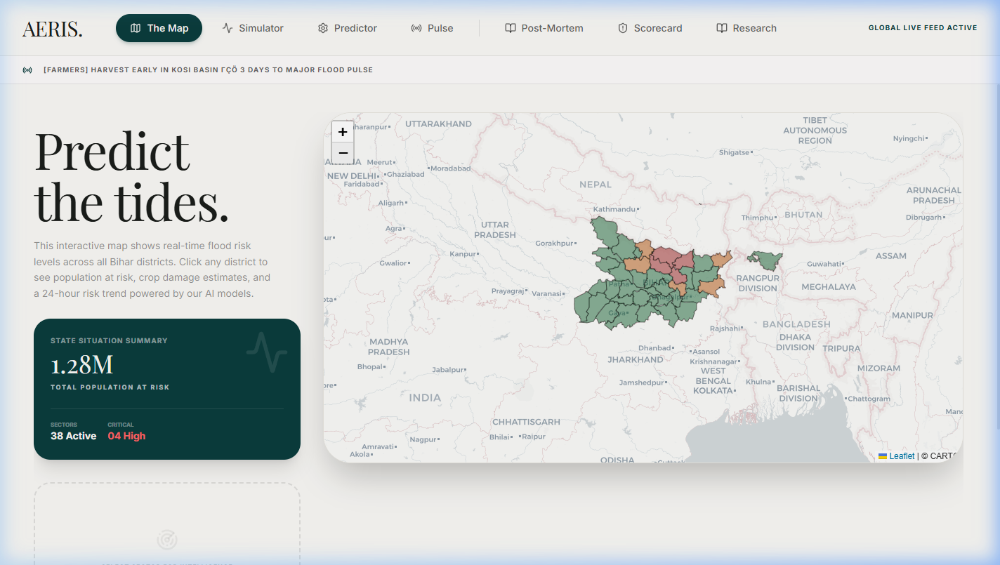
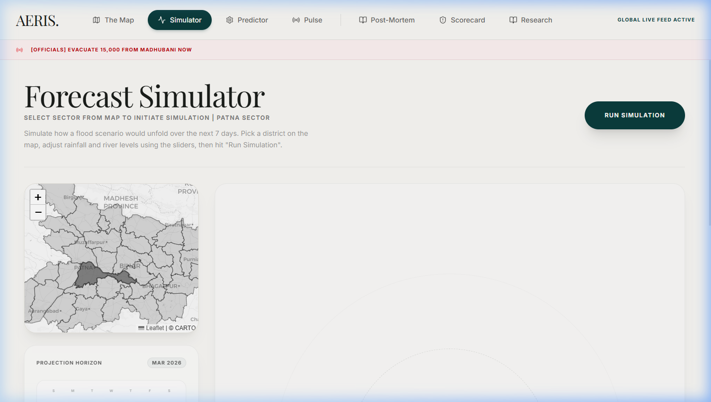
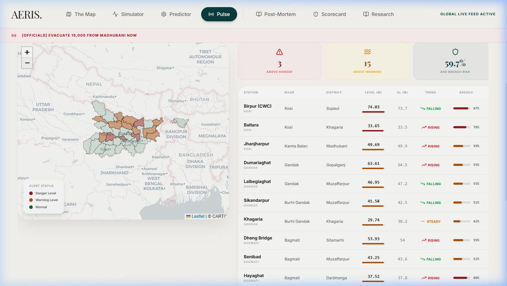

# AERIS — AI-Enhanced Risk Intelligence System

> **Predict. Prepare. Protect.** A high-precision, AI-driven emergency management platform that replaces reactive disaster response with proactive, ML-powered intelligence — built specifically for Bihar's annual flood crisis.

---

## 🖼️ Visual Showcase

### Forensic Risk & Predictive Intelligence

*A high-fidelity GIS interface providing district-level forensic risk coloring and real-time situation room telemetry.*

### 7-Day Forecast Simulator

*An interactive 7-day projection engine where researchers can adjust precipitation and river parameters to simulate hydraulic outcomes.*

### Real-Time River Pulse

*Live monitoring of 18 gauge stations across 5 major basins with active XGBoost-driven breach probability monitoring.*

---

## 🌊 The Crisis (Problem Statement)
Bihar is India's most flood-prone state, with **76% of the North Bihar population** living under recurring threats. Every monsoon, rivers like the Kosi and Gandak breach aging embankments, causing catastrophic damage.

### The Critical Gaps:
- **Information Latency**: Manual gauge reporting takes **6–12 hours** to reach decision-makers. By then, villages are often already submerged.
- **Reactive Response**: Current systems deploy *after* flooding begins. Evacuation windows are missed, and resource staging is delayed by critical hours.
- **Infrastructure Decay**: Embankments built in the 1950s have minimal maintenance budgets. No predictive model exists to prioritize repairs based on breach probability.
- **Resource Inefficiency**: Relief is distributed evenly rather than by statistical vulnerability, leaving the most at-risk zones under-served.

---

## 🔍 Competitive Analysis & Gaps

| System | Primary Function | The Forensic Gap & Failure Point |
|:---|:---|:---|
| **CWC Forecasting** | Text-based bulletins | Manual collection with 12hr lag; no spatial visualization or ML logic. |
| **FMIS Bihar** | Web portal data tables | Raw data only—lacks actionable intelligence or "What-If" scenario logic. |
| **NDMA Decision Support** | Macro-level coordination | Static risk maps based on history, not dynamic real-time ML triggers. |
| **Academic Research** | Published ML papers | High theoretical value but never deployed as a functional, real-time UI. |

---

## 💡 The AERIS Solution
**Core Thesis**: *If we can predict where and when an embankment will breach — before it happens — we can transform flood response from reactive chaos into proactive precision.*

AERIS uses **dual XGBoost models** trained on Bihar-specific river telemetry, rainfall intensity, and infrastructure age to provide:

### Platform Architecture (7 Modules)
1. **Live Risk Map**: Interactive GIS with 24-hour risk trend sparklines and population-at-risk counters.
2. **Forecast Simulator**: Multi-variate 7-day simulation engine with granular model execution logs.
3. **River Pulse**: Real-time telemetry monitoring (18 stations) with automated alert color-coding.
4. **Resilience Scorecard**: Multi-dimensional ranking of district preparedness (Infrastructure, Medical, Shelter).
5. **Post-Mortem**: Forensic hydraulic stress analysis and timeline reconstruction (Learning from History).
6. **ML Predictor**: Manual parameter override for "What-If" scenario execution.
7. **Research Review**: Scholarly technical overview of the system's architecture and problem-solution fit.

---

## 🛠️ Technology Stack
- **ML Engine**: XGBoost (Dual models: Breach Prediction + Flood Classification).
- **Backend API**: FastAPI (Python) with real-time inference latency optimizations.
- **Frontend GUI**: React 19 + Vite + Tailwind CSS 4 + Framer Motion.
- **GIS Core**: React-Leaflet + GeoJSON with responsive zoom accessibility (7.5 - 8.5).
- **Design System**: Editorial Design (Playfair Display, Charcoal/Teal palette, Glassmorphism).

---

## ⚡ Quickstart

### 1. Backend Setup
```bash
# Install dependencies
pip install -r requirements.txt

# Start the API server
python -m uvicorn api.main:app --host 0.0.0.0 --port 8000 --reload
```

### 2. Frontend Setup
```bash
cd frontend
npm install
npm run dev
```

---

## 🏆 Impact & Differentiators
- **Evacuation Lead Time**: 7-day predictive warnings enable pre-positioned resources.
- **Localized Precision**: Trained on Bihar-specific river basins, not generic national rainfall models.
- **Forensic Accountability**: Transparency in district rankings drives infrastructure investment.

---

> **AERIS** — Built for Bihar. Powered by AI. Designed for Impact.
